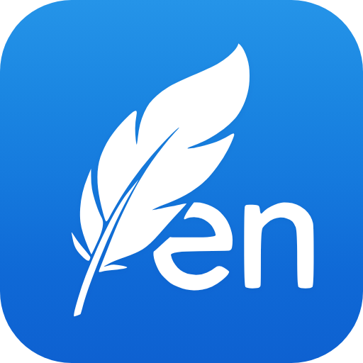
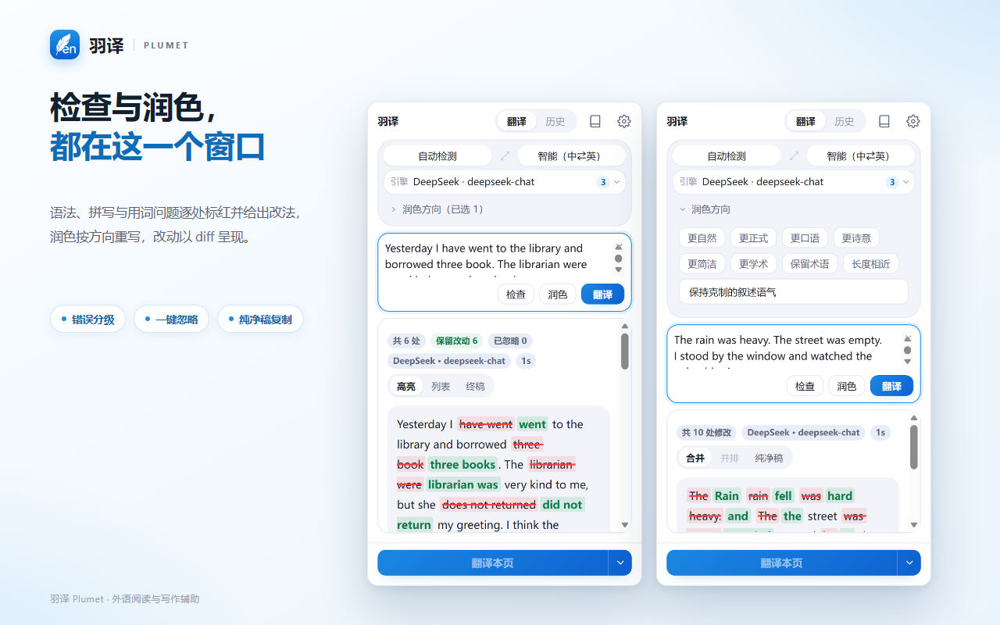
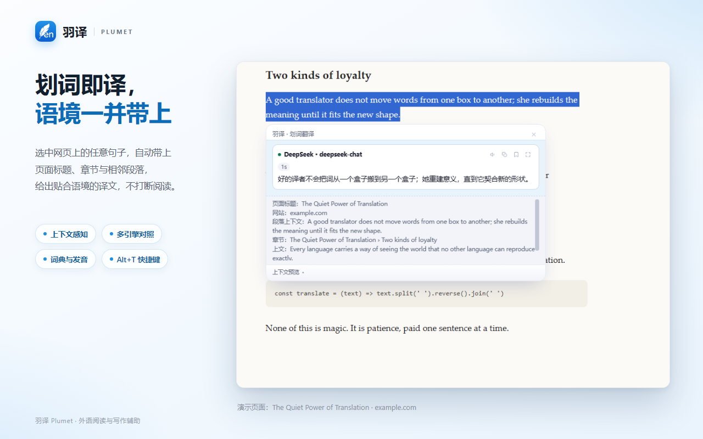
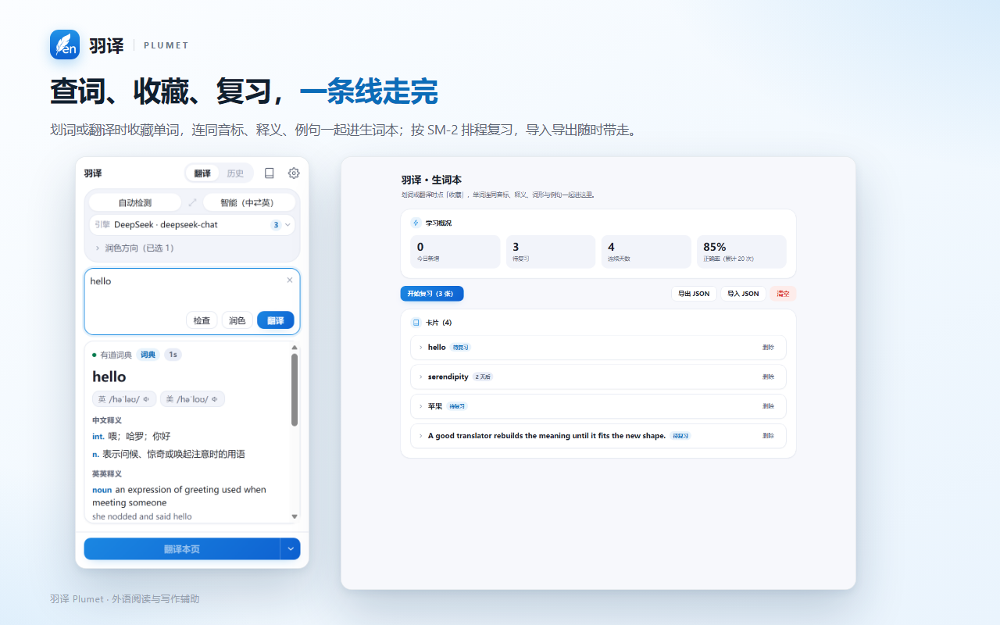
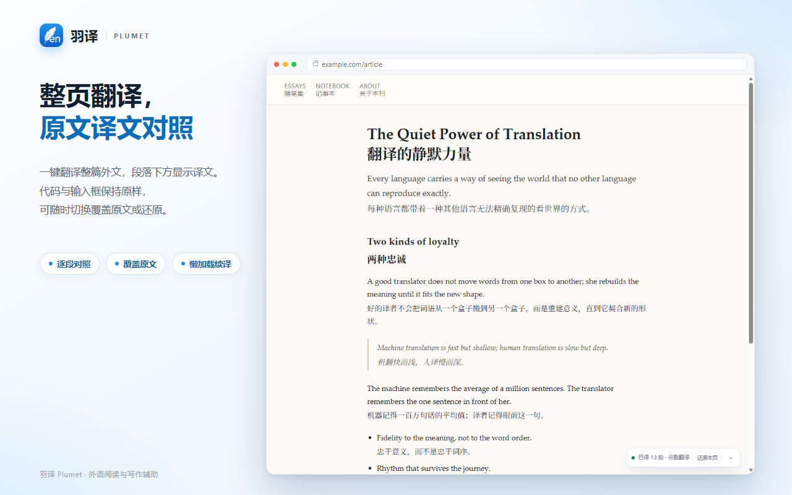
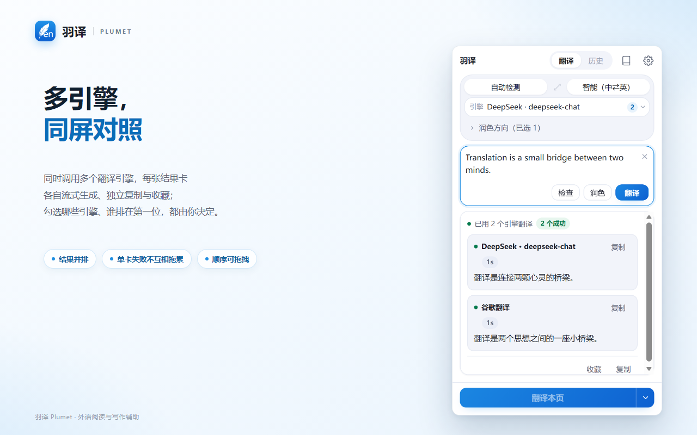

<h1 align="center">羽译（Plumet）</h1>

> 是「词元」还是「令牌」抑或「代币」？
>
> 把「翻译 → 检查 → 润色 → 记住」串成一条线的浏览器扩展。

<p align="center">
  
  
  
  
  
  
</p>

<p align="center">
  
</p>

## 功能特性

### 翻译、检查、润色

工具栏弹窗中输入要翻译的内容：`Enter` 直接翻译，点「检查」用荧光笔标出错误，点「润色」拿到可复制的 diff 改稿。

<p align="center">
  
</p>
<p align="center"><sub>同一个输入框：翻译入口、语法检查标注与润色 diff</sub></p>

### 划词翻译自带上下文

选中文字出现插件图标，点击即翻；自动带上所在段落、标题链、相邻段落与列表/表格，多义词与代词按语境落地，而不是孤立地翻译一句。

<p align="center">
  
</p>
<p align="center"><sub>气泡贴着选区；展开「上下文预览」能看到本次实际发出的段落与章节</sub></p>

### 查词典、收藏、复习

英文词与 1–4 个汉字不走句子翻译，直接查有道词典或 Free Dictionary：音标与真人发音、中文释义、英英释义、词形变化、双语例句、常用词组；未收录时自动回退句翻模式。词句连同词典快照收进生词本，按简化 SM-2 排期复习，统计今日新增、待复习、连续天数与正确率，JSON 导入导出。

<p align="center">
  
</p>
<p align="center"><sub>左边是词典卡，右边是生词本：查词、收藏、复习一条线</sub></p>

### 整页双语对照

段落级翻译，双语显示与仅译文可随时切换；重复翻译与页面改版后的段落命中缓存，不重复计费。

<p align="center">
  
</p>
<p align="center"><sub>整页双语对照；右下角状态条可切换呈现、重试失败段落或还原本页</sub></p>

### 多引擎并列对照

AI 服务与机器翻译可勾选多个并拖动排序，同一句按顺序并排每家译文，每张卡单独复制、朗读、收藏；只用配置完整的服务，失败直接报错，不偷偷换引擎。

<p align="center">
  
</p>
<p align="center"><sub>勾选多个引擎，同一句按顺序各出一张结果卡</sub></p>

### 前置要求

- Chromium 内核浏览器 **≥ 114**：Microsoft Edge 或 Chrome
- 检查与润色需要至少一个可用的 AI 服务；翻译有免 Key 的免费通道，装好即可用

### 从源码加载

```powershell
git clone https://github.com/IsNotChangchengY/Plumet.git
cd Plumet
pnpm install
pnpm build
```

- Edge：地址栏输入 `edge://extensions` → 左下角「开发人员模式」→「加载解压缩的扩展」→ 选择 **`dist`** 目录。
- Chrome：地址栏输入 `chrome://extensions` → 右上角「开发者模式」→「加载已解压的扩展程序」→ 选择同一个 **`dist`** 目录。

加载成功后点工具栏的「羽 en」图标（没看到就点浏览器右上角的拼图按钮固定），图标下方弹出翻译窗口；输入一句英文按 `Enter`，应看到译文。

改完代码需要 `pnpm build` 后在扩展页点一次刷新；弹窗关掉重开，已打开的网页也要刷新。正式版 Chrome 137 起不再支持用命令行 `--load-extension` 加载未打包扩展，请按上面的步骤手动加载。

### 打包分发包

```powershell
pnpm package
```

生成 `release/yuyi-1.0.0.zip`，解压到任意目录后，按「从源码加载」的步骤加载解压出来的文件夹即可（Edge 与 Chrome 都支持）。

不想装开发环境也行：维护者推送 `v<版本>` 标签后，GitHub Actions 会自动构建 `extension.zip` 并发布到 [Releases](https://github.com/IsNotChangchengY/Plumet/releases)（同时附 `SHA256SUMS.txt` 校验文件），Release 正文是维护者写的本次更新说明；下载解压后按「从源码加载」的步骤选择解压目录即可。

### 配置翻译服务

- **免费通道**：谷歌翻译、MyMemory 免 Key。
- **需要密钥的机器翻译**：百度（AppID + 密钥）、微软 / 必应（Azure Translator v3：Key + 区域），在 设置 →「服务」里填写。
- **AI 服务**：检查与润色只能用 AI。在 设置 →「服务」里添加一个内置预设（OpenAI / Gemini / DeepSeek / 智谱 等）或自定义 OpenAI 兼容 Base URL。

## 项目结构

```text
src/background/   Service Worker：唯一联网方，消息路由、缓存、历史与任务表
src/content/      Content Script：划词气泡、守卫态与网页翻译（不引 React）
src/popup/        工具栏弹窗（唯一界面，340×600）：翻译 / 检查 / 润色 / 历史
src/options/      设置页（新标签页）：通用 / 翻译 / 词典 / 引擎 / 服务 / 其它
src/learning/     生词本页面：统计、卡片列表、复习台
src/app/          弹窗里复用的 React 组件
src/core/         与界面无关的逻辑：服务商、词典、缓存、引擎路由、messaging 等
src/storage/      chrome.storage.local 封装：settings / history / learning
src/ui/           设计变量（theme.css）与主题应用
public/           manifest.json 与扩展图标（矢量源在 assets/icon-master.svg）
scripts/          构建、产物自检、文档路径检查与零依赖打包
tests/            Vitest 单元测试与可选的联网冒烟测试
docs/             设计大纲、UI 规范、服务商文档与新手四篇教程、隐私政策页
```

## 贡献指南

开发环境、提交前门禁、代码约定、改动类型对照与 PR 流程见 [CONTRIBUTING.md](CONTRIBUTING.md)。最少要记住三件事：

1. `pnpm check` 全绿（类型 + 单测 + 构建 + 产物自检 + 文档检查）再提 PR。
2. 按 [docs/README.md](docs/README.md) 的规则同步受影响的文档；用户可见功能变化更新本 README 的功能章节。
3. 新增依赖前先确认现有 4 个运行时依赖与浏览器 API 做不到；新增服务商先读 [docs/providers.md](docs/providers.md)。

提交信息用 `<type>: <中文摘要>` 的格式，一个 PR 只做一件事；沟通约定写在 CONTRIBUTING 第 9 节。

## 隐私

羽译不收集遥测、不要求账号、不出售数据。哪些文本会发往你配置的翻译服务、哪些数据只留在本机、扩展申请了哪些权限，见[隐私政策](https://isnotchangchengy.github.io/Plumet/privacy.html)（页面源码在 [docs/privacy.html](docs/privacy.html)，由 GitHub Actions 发布到 GitHub Pages）。

## 许可证

本项目以 **Apache License 2.0** 许可发布，完整条款见 [LICENSE](LICENSE)。

你可以自由使用、修改与分发本项目的代码（包括商用）；分发时需保留版权与许可声明，并在修改过的文件中注明改动。软件按「原样」提供，不附带任何明示或暗示的担保。
